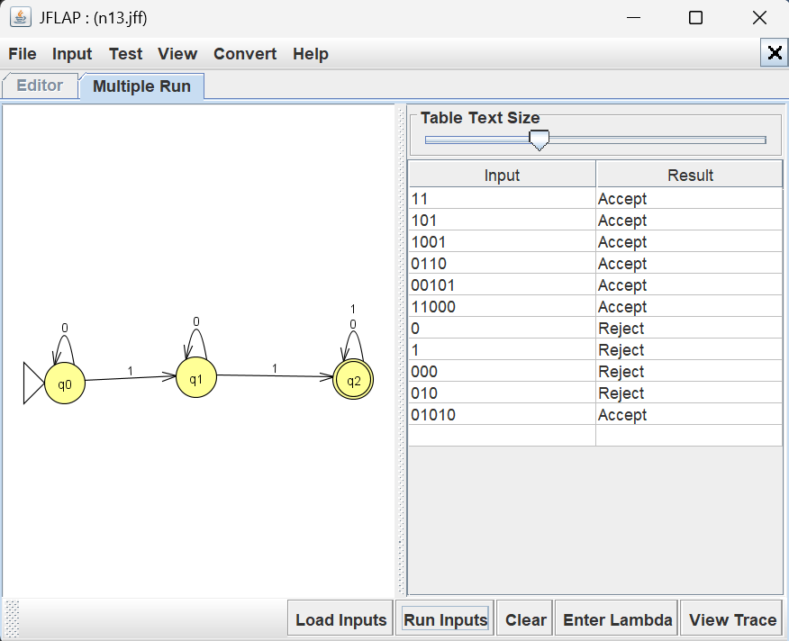
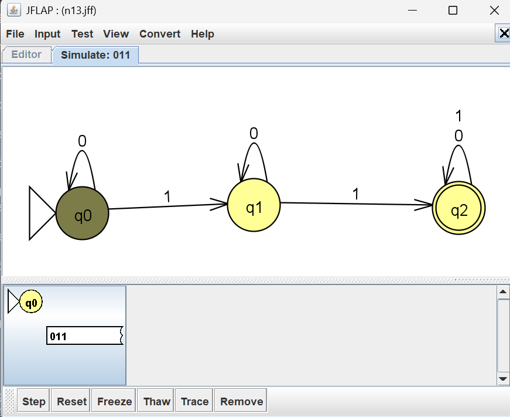
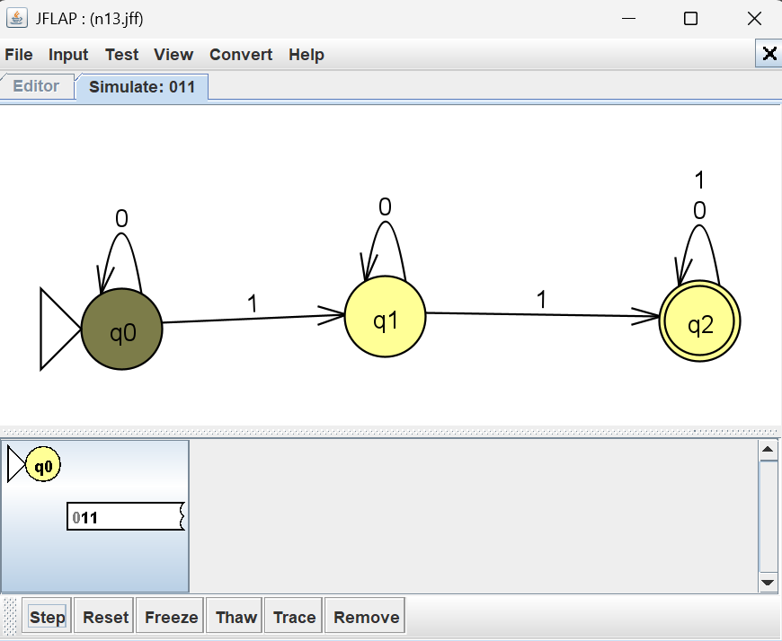
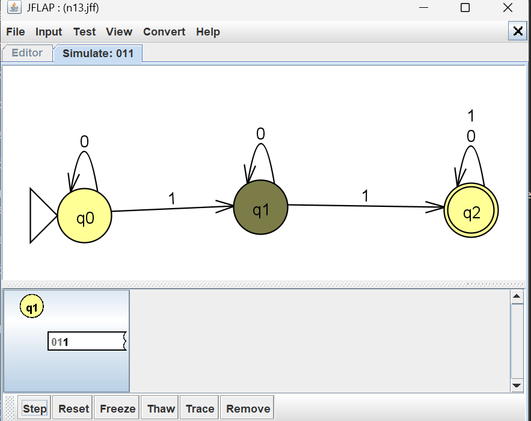
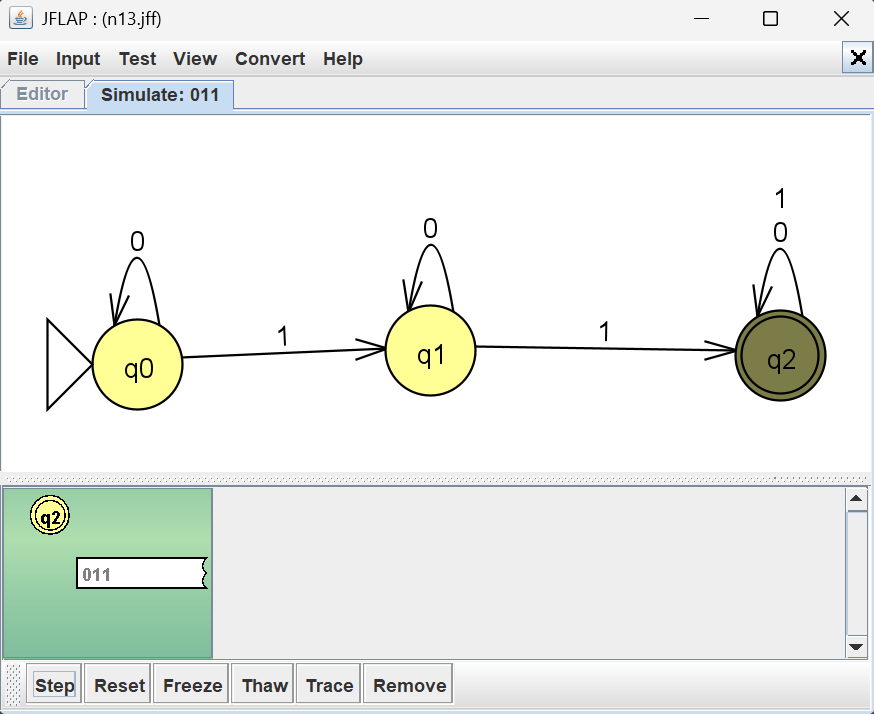

# Problem 13 NFA Report

## Language

This NFA recognizes strings over the alphabet `{0,1}` that contain at least 2 1's

Examples of accepted strings include: '11', '011', '111 ', '1010' 

Examples of rejected strings include `0`, `1`, `000`, `100`.

## NFA Design & Batch Run Results

I tested the NFA using JFLAP's Multiple Run feature. The results confirmed that the NFA
design was accurate.

## Mistakes or Difficulties

This particular NFA wasn't difficult, which was good for getting used to the JFLAP program.

## Gold String Investigation

The string 011 was used to demonstrate how the NFA processes the accepting string.

