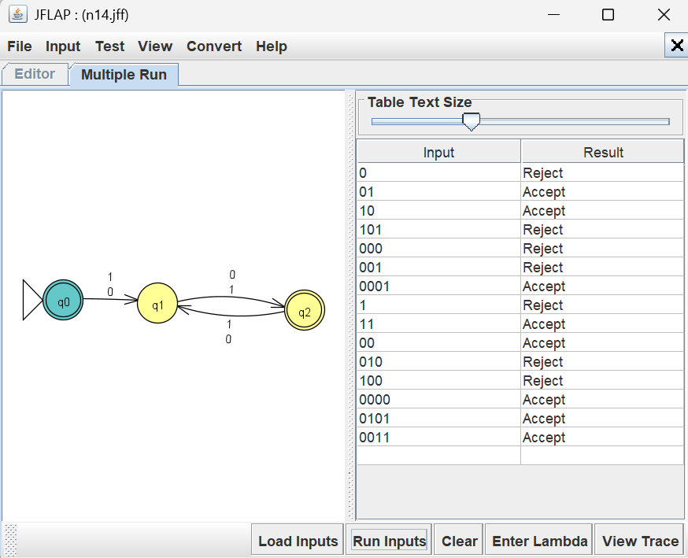
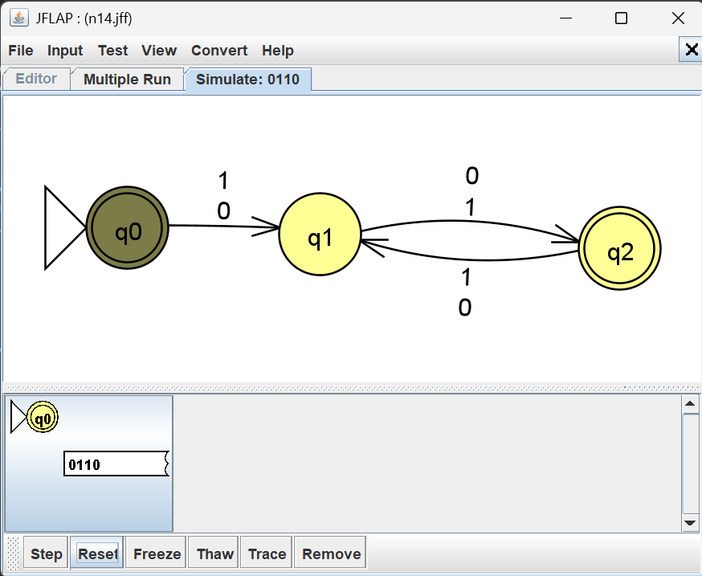
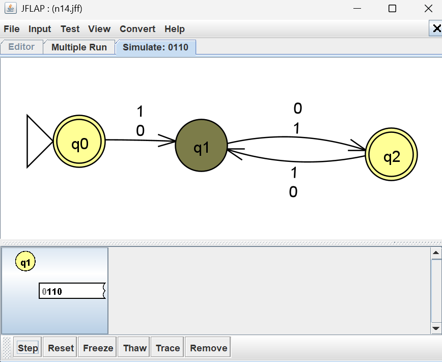
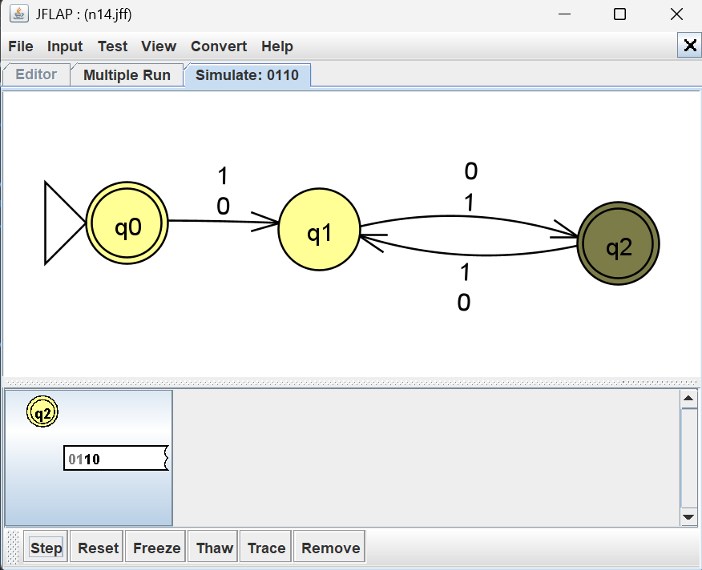
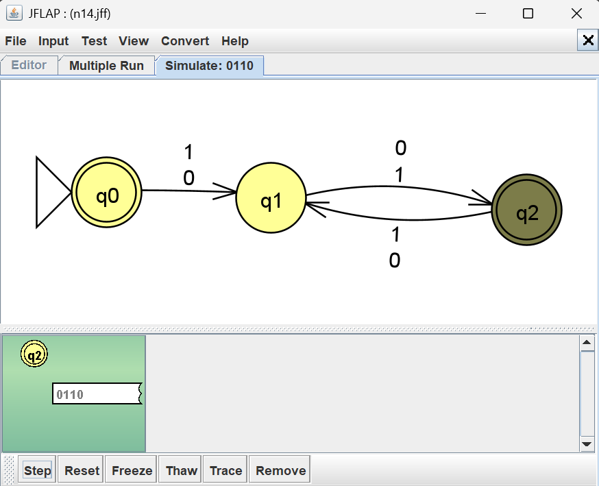

# Problem 14 NFA Report

## Language

This NFA recognizes even-length strings over the alphabet '{0,1}' 

Examples of accepted strings include: '11', '0110', '111000'

Examples of rejected strings include '0', '1', '000', '100'.

## NFA Design & Batch Run Results

I tested the NFA using JFLAP's Multiple Run feature. The results confirmed that the NFA
design was accurate.

## Mistakes or Difficulties

This particular NFA wasn't difficult. One mistake I made was making the empty string reject.

## Gold String Investigation

The string '0110' originally was being rejected instead of accepted. After fixing the accepting states loops the NFA follows this process: 

