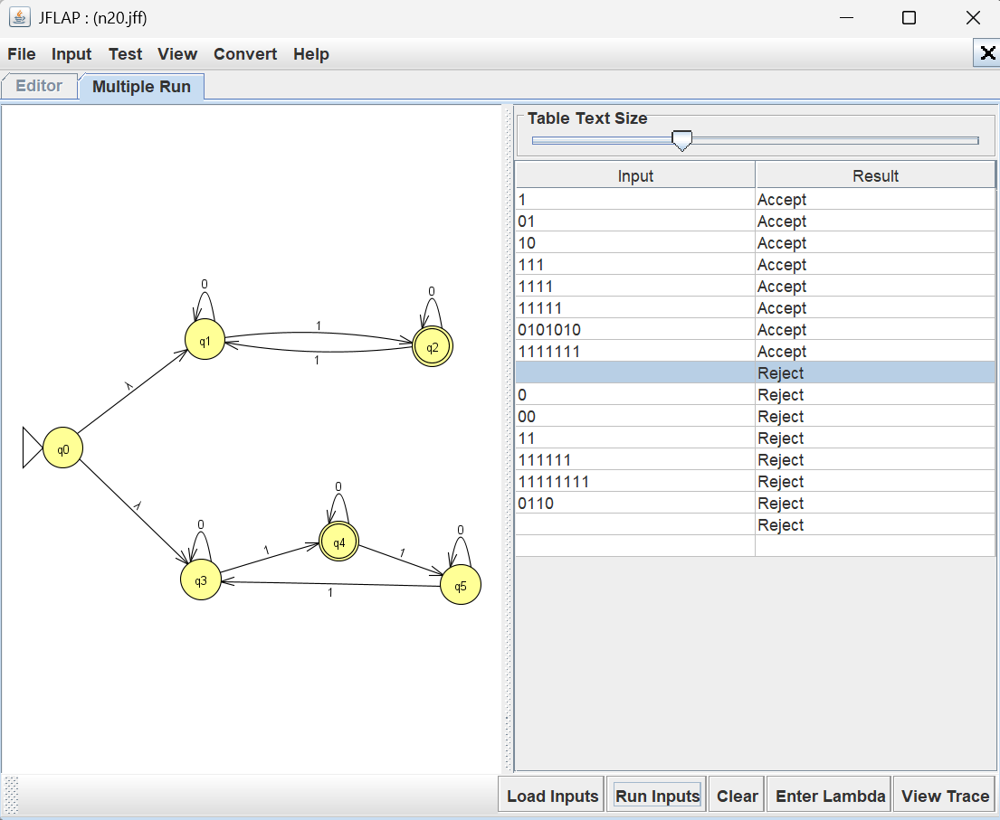
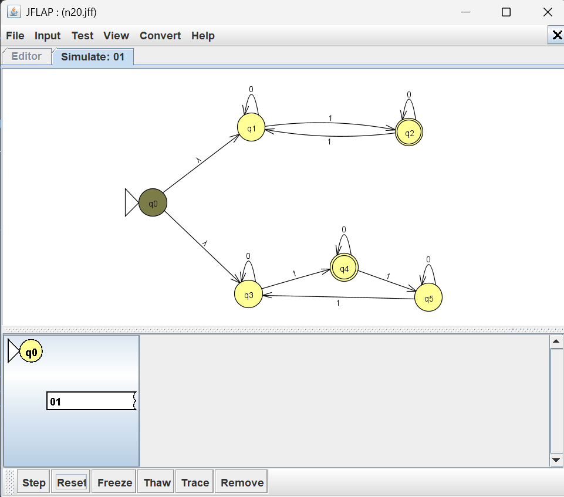
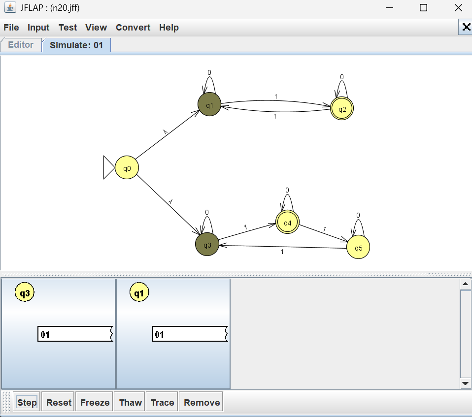
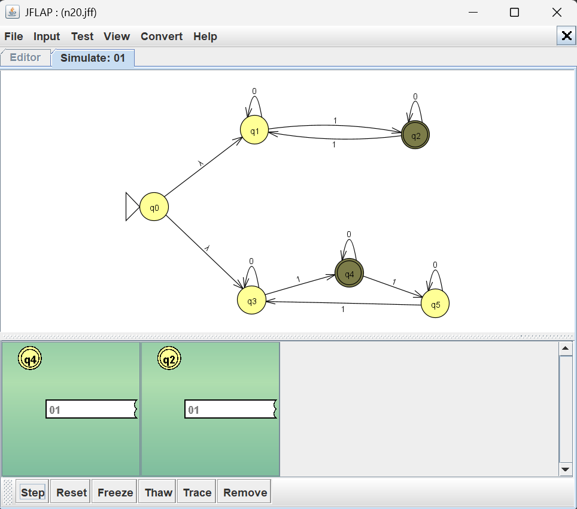

# Problem 20 NFA Report

## Language

This NFA recognizes strings over the alphabet {0,1} that have 3k+1 of 1's, where k>=0, or an odd number of 0s 

Examples of accepted strings include: '0', '001', '1111', '000'

Examples of rejected strings include '00', '0011', '11', '111'.

## NFA Design & Batch Run Results

I tested the NFA using JFLAP's Multiple Run feature. The results confirmed that the NFA
design was accurate.

## Mistakes or Difficulties

I found this NFA design particularly difficult as it was my first NFA design involving OR.

## Gold String Investigation

The string 01 was used to demonstrate how the NFA processes inputs through multiple paths.

