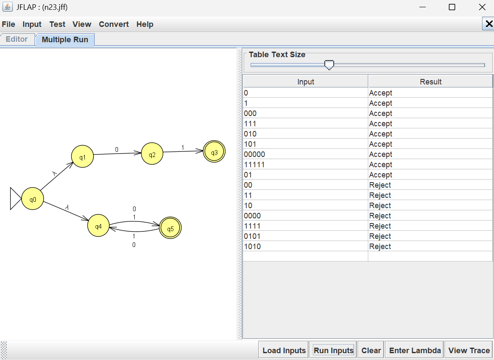

# Problem 23 NFA Report

## Language

This NFA recognizes strings over the alphabet {0,1} with either an odd string length or string = 01 

Examples of accepted strings include: '01', '001', '11110', '000'

Examples of rejected strings include '11', '00', '0101', '1100'.

## NFA Design & Batch Run Results

I tested the NFA using JFLAP's Multiple Run feature. The results confirmed that the NFA
design was accurate.

## Mistakes or Difficulties

This NFA design wasn't difficult since the cases were both straightforward and just combined the ideas of past NFA designs.
