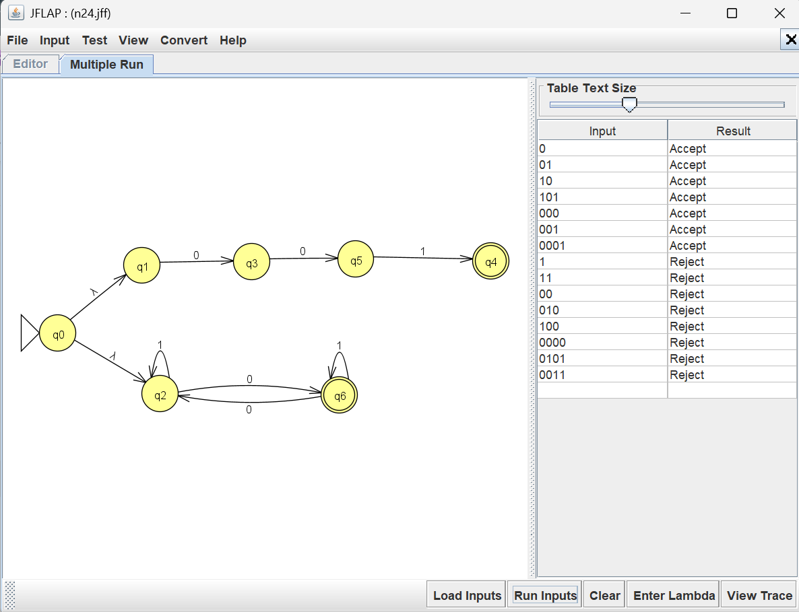

# Problem 24 NFA Report

## Language

This NFA recognizes strings over the alphabet {0,1} with odd # of 0's or string = 001

Examples of accepted strings include: '01', '001', '11110', '000'

Examples of rejected strings include '11', '00', '0101', '1100'.

## NFA Design & Batch Run Results

I tested the NFA using JFLAP's Multiple Run feature. The results confirmed that the NFA
design was accurate.

## Mistakes or Difficulties

I made early mistakes when dealing with the input 1 for the first case.

